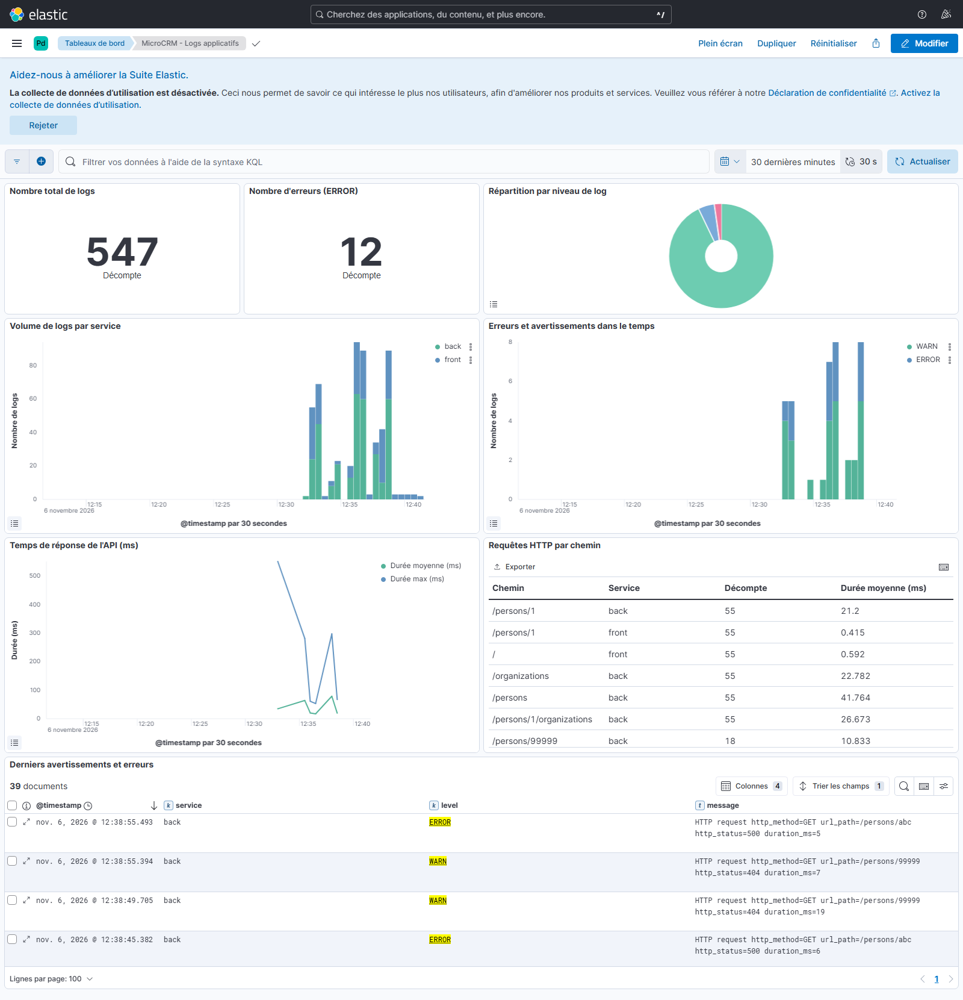

# Documentation technique – MicroCRM (Orion)

| | |
|---|---|
| **Titre** | Documentation technique – Industrialisation CI/CD de MicroCRM |
| **Auteur** | Bruno Hoarau |
| **Option choisie** | Option B (Scénario Orion) |
| **Date** | 05/11/2026 |
| **Dépôt** | https://github.com/brunoHoarau/Hoarau_Bruno_09_Gerez_un_projet_d-integration_et_de_deploiement_continu |

> Statut : les plans (sections 3, 4 et 5) sont définis **avant** toute mise en œuvre technique. Les sections marquées « à compléter » le seront au fil de la réalisation du pipeline.

---

## 1. Introduction

### 1.1 Contexte du projet

Orion souhaite moderniser la livraison de son application interne **MicroCRM**, un CRM simplifié permettant de créer, modifier et consulter des individus rattachés à des organisations. Aujourd'hui, la construction, les tests et le déploiement sont manuels : aucune chaîne CI/CD, aucune analyse qualité, aucune orchestration de conteneurs.

### 1.2 Objectifs de l'industrialisation

- Automatiser **build, tests, analyse qualité/sécurité, conteneurisation et déploiement** à chaque modification du code.
- Détecter les régressions et les vulnérabilités **avant** qu'elles n'atteignent la branche principale.
- Rendre le déploiement **reproductible** (images Docker versionnées, Docker Compose).
- Réduire la dette technique en la rendant **visible et mesurée** (SonarQube Cloud).

### 1.3 Technologies principales

| Composant | Technologie | Version actuelle du projet | Statut (nov. 2026) |
|---|---|---|---|
| Back-end | Spring Boot (Spring Data REST, JPA) | 3.2.5 | Hors support OSS |
| Langage back | Java | 17 (compilation) / 21 (exécution Docker) | LTS supportées |
| Build back | Gradle (wrapper) | 8.7 | Branche 8 en maintenance (actuelle : 9.8) |
| Base de données | HSQLDB **en mémoire** | – | Données non persistantes |
| Front-end | Angular | 17.3 | Hors support (versions supportées : 20, 21, 22) |
| Tests front | Karma + Jasmine (Chrome Headless) | Karma 6.4 | – |
| Serveur web front | Caddy (Alpine) | Alpine 3.19 | Alpine 3.19 hors support |
| CI/CD | GitHub Actions | – | À mettre en place |
| Qualité / sécurité | SonarQube Cloud | – | À mettre en place |
| Orchestration | Docker Compose | – | À mettre en place |

### 1.4 État des lieux

**Organisation du code (monorepo)**

```
back/            API Spring Boot (Gradle)
front/           Application Angular (npm)
misc/docker/     Caddyfile (serveur web) et supervisor.ini (image tout-en-un)
Dockerfile       Build multi-stage : cibles front, back, standalone
```

**Commandes locales vérifiées**

| Action | Commande | Résultat constaté |
|---|---|---|
| Build back (inclut les tests) | `cd back && ./gradlew build` | OK – JAR `build/libs/microcrm-0.0.1-SNAPSHOT.jar` |
| Tests back | `cd back && ./gradlew test` | OK – 2 tests |
| Installation front | `cd front && npm ci` | OK – 90 vulnérabilités npm signalées (dont 5 critiques) |
| Build front | `cd front && npx ng build` | OK – `dist/microcrm/browser` |
| Tests front (mode CI) | `cd front && npx ng test --watch=false --browsers=ChromeHeadless --code-coverage` | OK – 8 tests, ~31 % de couverture des lignes |

**Tests existants**

- Back : `MicroCRMApplicationTests` (démarrage du contexte Spring) et `PersonRepositoryIntegrationTest` (test d'intégration JPA de `findByEmail`).
- Front : 8 tests Jasmine, essentiellement des tests de création de composants/services (« should create ») et du titre de l'application.

**Contraintes techniques identifiées pour la CI/CD**

1. `back/gradlew` n'a pas le droit d'exécution dans Git : `Permission denied` sur un runner Linux et dans le build Docker.
2. `FROM node` sans version : build front non reproductible ; Angular 17 ne supporte officiellement que Node 18/20 (en fin de vie).
3. Étage `back` du Dockerfile : `EXPOSE 4200` alors que l'API écoute sur **8080**.
4. Image de base `alpine:3.19` hors support, conteneurs exécutés en `root`.
5. `./gradlew build` dans le Dockerfile ré-exécute les tests déjà joués en CI.
6. `ng test` est en mode « watch » par défaut ; la CI doit forcer `--watch=false` et un navigateur headless.
7. Aucun rapport de couverture exploitable par SonarQube (pas de JaCoCo côté back, pas de rapport `lcov` côté front).
8. URL de l'API codée en dur dans le front (`http://localhost:8080`) : l'API doit être publiée sur le port 8080 de l'hôte.
9. Base HSQLDB en mémoire : aucune donnée persistante à ce jour.
10. API sans authentification et CORS ouvert à `*`.

### 1.5 Présentation rapide du pipeline CI/CD

Le workflow `.github/workflows/ci.yml` exécute en parallèle deux jobs, back-end et front-end. Chacun construit son application, exécute les tests existants, mesure la couverture et soumet le code à SonarQube Cloud, dont la Quality Gate bloque le pipeline en cas d'échec. Les rapports sont publiés en artefacts. Si ces deux jobs réussissent, le job `docker` construit les images, démarre l'application avec Docker Compose, la vérifie (smoke test) et scanne les images avec Trivy. Pour un push sur `main` ou un tag de release `v*`, il publie ensuite les images sur GitHub Container Registry, et le job `deploy` les déploie avec Docker Compose. Dependabot (`.github/dependabot.yml`) propose chaque semaine les mises à jour de dépendances, qui passent elles-mêmes par le pipeline.

---

## 2. Étapes de mise en œuvre du pipeline CI/CD

### 2.1 Structure du pipeline

```
            ┌──────────── job "back" ────────────┐
 push /     │ build + tests + JaCoCo → SonarQube │──┐
 tag v* /   └────────────────────────────────────┘  │   ┌────────── job "docker" ──────────┐   ┌──────── job "deploy" ────────┐
 PR /   ──►                                         ├──►│ compose build → compose up       │──►│ compose pull → compose up    │
 nightly /  ┌──────────── job "front" ───────────┐  │   │ → smoke test → scan Trivy        │   │ → vérification               │
 manuel     │ build + tests + lcov → SonarQube   │──┘   │ → push GHCR (main / tag v*)      │   │ (main / tag v* uniquement)   │
            └────────────────────────────────────┘      └──────────────────────────────────┘   └──────────────────────────────┘
                        CI                                       CD : livraison                       CD : déploiement
```

**Déclencheurs** (conformes au plan de testing, section 4.2) :

| Déclencheur | Configuration |
|---|---|
| Push sur toute branche | `push: branches: ["**"]` |
| Release | `push: tags: ["v*"]` (par exemple `git tag v1.0.0 && git push origin v1.0.0`) |
| Pull request vers `main` | `pull_request: branches: [main]` |
| Nightly | `schedule: cron "0 2 * * *"` (tous les jours à 2 h UTC, sur `main`) |
| Manuel | `workflow_dispatch` |

**Ordre d'exécution :**

1. Les jobs `back` et `front` (CI) sont **indépendants et parallèles**, ce qui réduit la durée totale. Dans chaque job, les étapes sont séquentielles : un échec de build ou de test arrête le job avant l'analyse SonarQube. Les rapports sont publiés **même en cas d'échec** (`if: always()`) pour faciliter le diagnostic.
2. Le job `docker` ne démarre **que si `back` et `front` ont réussi** (`needs: [back, front]`). Il s'exécute à chaque run, mais il ne **publie** les images que pour un push sur `main` ou un tag `v*`.
3. Le job `deploy` ne démarre que si les images ont été publiées (`needs: docker`), et uniquement sur `main` ou un tag `v*`.

| Événement | back / front | docker (build, smoke test, scan) | Publication GHCR | deploy |
|---|---|---|---|---|
| Push sur une branche de travail | ✅ | ✅ | – | – |
| Pull request vers `main` | ✅ | ✅ | – | – |
| Push sur `main` (fusion) | ✅ | ✅ | ✅ `sha-xxxxxxx` + `latest` | ✅ |
| Tag `v*` (release) | ✅ | ✅ | ✅ `vX.Y.Z` | ✅ |
| Nightly / manuel | ✅ | ✅ | – | – |

**Justification des actions GitHub retenues** : uniquement des actions officielles et maintenues, épinglées sur leur dernière version majeure (vérifiée en novembre 2026).

| Action | Version | Rôle | Pourquoi ce choix |
|---|---|---|---|
| `actions/checkout` | v7 | Récupération du code | Action officielle GitHub ; `fetch-depth: 0` fournit l'historique complet dont SonarQube a besoin pour identifier le nouveau code et les auteurs |
| `actions/setup-java` | v6 | Installation du JDK | Action officielle ; distribution **Temurin 21** (LTS), identique au JRE de l'image Docker du back |
| `gradle/actions/setup-gradle` | v6 | Cache Gradle | Action officielle Gradle : cache des dépendances et du wrapper, **validation de l'intégrité du wrapper** (protection de la chaîne d'approvisionnement), résumé du build dans l'interface GitHub |
| `actions/setup-node` | v7 | Installation de Node.js | Action officielle ; **Node 24** (LTS, support jusqu'en avril 2028), compatible avec Angular 17 (`engines: >=20.9.0`) ; cache npm basé sur `package-lock.json` |
| `SonarSource/sonarqube-scan-action` | v8 | Analyse du front | Action officielle SonarSource ; vérifie la signature GPG du scanner téléchargé |
| `actions/upload-artifact` | v7 | Publication des rapports | Action officielle ; rapports consultables depuis la page du run pendant 14 jours |
| `docker/login-action` | v4 | Connexion à GHCR | Action officielle Docker ; utilise le `GITHUB_TOKEN` éphémère et se déconnecte automatiquement en fin de job |
| Docker Compose (CLI du runner) | v2 | Build, démarrage, publication des images | **Mêmes commandes et même fichier `docker-compose.yml` qu'en local** : pas d'action supplémentaire, aucune divergence entre poste de développement et CI |
| Trivy (image `aquasec/trivy`) | 0.76.2 | Scan des images | Scanner open source de référence, exécuté en conteneur (aucune installation) ; version figée |

**Outil de build back-end** : l'énoncé mentionne Maven, mais le projet existant utilise **Gradle** (wrapper 8.7). Le pipeline conserve Gradle pour ne pas réécrire le build : le wrapper garantit une version identique en local et en CI. Le back est analysé avec le **plugin Gradle `org.sonarqube`**, recommandé par SonarSource pour les projets Gradle (il récupère automatiquement sources, binaires et classpath).

**SonarQube Cloud, deux projets** : le dépôt est un monorepo contenant deux applications de technologies différentes. Elles sont analysées comme **deux projets SonarQube** (back et front), ce qui correspond au mode monorepo de SonarQube Cloud : chaque application a sa propre Quality Gate et ses propres indicateurs.

### 2.2 Scripts et fichiers d'automatisation

| Fichier | Rôle dans le pipeline |
|---|---|
| `.github/workflows/ci.yml` | Workflow CI : toute la logique d'automatisation est centralisée ici |
| `Dockerfile` | Build multi-stage des images `back` et `front` (section 3.1) |
| `docker-compose.yml` | Orchestration ; utilisé à l'identique en local, en CI (smoke test) et au déploiement (section 3.2) |
| `.github/dependabot.yml` | Mises à jour hebdomadaires des dépendances Gradle, npm, actions GitHub et images Docker |
| `back/build.gradle` | Ajout du plugin **JaCoCo** (rapport de couverture XML/HTML généré après les tests) et du plugin **`org.sonarqube`** (URL SonarQube Cloud, chemin du rapport JaCoCo, attente de la Quality Gate) |
| `front/karma.conf.js` | Ajout du reporter de couverture **`lcov`**, format lu par SonarQube |
| `front/sonar-project.properties` | Configuration statique de l'analyse front : sources, fichiers de tests, chemin `lcov`, attente de la Quality Gate |
| `back/gradlew` | Ajout du droit d'exécution dans Git (`git update-index --chmod=+x`), indispensable sur les runners Linux |

**Exécuter les mêmes étapes en local** :

```shell
# Back-end : build + tests + couverture (rapport : back/build/reports/jacoco/test/html/index.html)
cd back
./gradlew build jacocoTestReport

# Front-end : build + tests + couverture (rapport : front/coverage/microcrm/index.html)
cd front
npm ci
npx ng build
npx ng test --watch=false --browsers=ChromeHeadlessNoSandbox --code-coverage
```

#### Référence des commandes

| Commande | Objectif | Où elle est définie | Quand elle est exécutée |
|---|---|---|---|
| `./gradlew build jacocoTestReport` | Compiler le back, lancer **tous les tests back** (JUnit) et produire le rapport de couverture | Tâches Gradle : `back/build.gradle` ; appel : `.github/workflows/ci.yml` (job `back`) | CI (chaque run) ; local |
| `./gradlew sonar` | Envoyer l'analyse du back à SonarQube Cloud et attendre la Quality Gate | Plugin `org.sonarqube` : `back/build.gradle` ; appel : workflow (job `back`) | CI (si `SONAR_TOKEN` disponible) |
| `./gradlew bootJar` | Produire le JAR exécutable du back, sans tests | `Dockerfile` (étage `back-build`) | Build d'image : CI (job `docker`) ; local (`docker compose build`) |
| `npm ci` | Installer les dépendances front exactement selon `package-lock.json` | `front/package.json` ; appels : workflow (job `front`) et `Dockerfile` (étage `front-build`) | CI ; build d'image ; local |
| `npx ng build` | Construire le front en mode production | `front/angular.json` ; appels : workflow (job `front`) et `Dockerfile` | CI ; build d'image ; local |
| `npx ng test --watch=false --browsers=ChromeHeadlessNoSandbox --code-coverage` | Lancer **tous les tests front** (Karma/Jasmine) une seule fois, sans interface, avec couverture `lcov` | `front/angular.json` et `front/karma.conf.js` ; appel : workflow (job `front`) | CI (chaque run) ; local |
| `npm audit --omit=dev --audit-level=high` | Signaler les vulnérabilités des dépendances de production du front (non bloquant) | Workflow (job `front`) | CI (chaque run) |
| `sonarqube-scan-action` | Envoyer l'analyse du front à SonarQube Cloud et attendre la Quality Gate | Workflow (job `front`) + `front/sonar-project.properties` | CI (si `SONAR_TOKEN` disponible) |
| `docker compose build` | Construire les images `back` et `front` | `docker-compose.yml` + `Dockerfile` ; appel : workflow (job `docker`) | CI (chaque run) ; local |
| `docker compose up -d --wait` | Démarrer l'application et attendre que les healthchecks soient au vert | `docker-compose.yml` ; appels : workflow (jobs `docker` et `deploy`) | CI ; déploiement ; local |
| `curl -fsS http://localhost:8080/persons` et `curl -fsSk https://localhost/` | **Smoke test** : vérifier que l'API et le front répondent | Workflow (jobs `docker` et `deploy`) | CI ; déploiement |
| `docker run aquasec/trivy image …` | Scanner les images (vulnérabilités hautes/critiques, secrets) | Workflow (job `docker`) | CI (chaque run, non bloquant) ; local |
| `docker compose push` | Publier les images taguées `IMAGE_TAG` sur GHCR | `docker-compose.yml` (noms d'images) ; appel : workflow (job `docker`) | CD : push sur `main` ou tag `v*` |
| `docker compose pull` puis `docker compose up -d --no-build --wait` | Déployer les images publiées, sans reconstruction | Workflow (job `deploy`) | CD : push sur `main` ou tag `v*` ; serveur cible (manuel) |

**Adapter le pipeline** : les versions de Java et de Node sont centralisées dans le bloc `env:` du workflow (`JAVA_VERSION`, `NODE_VERSION`). Les seuils de qualité se règlent dans la Quality Gate de SonarQube Cloud, sans modifier le workflow.

### 2.3 Reproductibilité et gestion des secrets

**Configuration requise (une seule fois)**

1. **SonarQube Cloud** (https://sonarcloud.io) : se connecter avec GitHub, importer l'organisation, puis analyser le dépôt en mode **monorepo** en créant deux projets (back et front).
2. Dans chaque projet SonarQube : *Administration → Analysis Method* → **désactiver l'« Automatic Analysis »** (incompatible avec l'analyse par la CI).
3. Générer un jeton : *My Account → Security → Generate Token*.
4. Dans GitHub, *Settings → Secrets and variables → Actions* :

| Type | Nom | Valeur |
|---|---|---|
| **Secret** | `SONAR_TOKEN` | Jeton SonarQube Cloud |
| Variable | `SONAR_ORGANIZATION` | Clé de l'organisation SonarQube Cloud |
| Variable | `SONAR_PROJECT_KEY_BACK` | Clé du projet back |
| Variable | `SONAR_PROJECT_KEY_FRONT` | Clé du projet front |

5. Recommandé : *Settings → Branches* → protéger `main` (fusion par pull request uniquement, checks `Back-end` et `Front-end` obligatoires).

**Gestion des secrets (sans jamais les afficher)**

- Le seul secret, `SONAR_TOKEN`, est stocké dans **GitHub Secrets** et transmis aux étapes via une variable d'environnement. GitHub le **masque automatiquement** dans les logs ; il n'apparaît dans aucun fichier du dépôt.
- Les identifiants non sensibles (organisation, clés de projet) sont des **variables GitHub** (`vars.*`) : ils peuvent changer sans modifier le code.
- Les pull requests venant de forks ne reçoivent pas les secrets : l'étape SonarQube est alors **ignorée** (`if: env.SONAR_TOKEN != ''`), mais le build et les tests s'exécutent normalement.
- Le workflow s'exécute avec des **permissions minimales** (`contents: read`). Seul le job `docker` reçoit `packages: write` (publication) et le job `deploy` `packages: read` (récupération).
- La connexion à GHCR utilise le **`GITHUB_TOKEN`** éphémère généré par GitHub pour chaque run : aucun mot de passe ni jeton de registre n'est stocké.

**Relancer le pipeline**

- Automatiquement à chaque push ou pull request.
- Manuellement : onglet *Actions* → *CI* → *Run workflow* (déclencheur `workflow_dispatch`).
- Pour relancer un run échoué : bouton *Re-run jobs* de la page du run.

**Consulter les résultats**

- **Statut** de chaque job dans l'onglet *Actions* et sur la pull request (checks).
- **Logs détaillés** de chaque test (plugin `test-logger` côté back, Karma côté front).
- **Artefacts** `back-reports` (rapports JUnit et JaCoCo) et `front-coverage` (rapport de couverture HTML), téléchargeables depuis la page du run.
- **Tableau de bord SonarQube Cloud** : bugs, vulnérabilités, security hotspots, code smells, couverture, duplications, statut de la Quality Gate, et commentaire automatique sur les pull requests.

---

## 3. Plan de conteneurisation et de déploiement

### 3.1 Dockerfiles

#### Analyse du Dockerfile existant

Le dépôt contient un **Dockerfile unique à la racine**, en *multi-stage build* : les étages de compilation (Node, JDK, outils de build et sources) sont séparés des étages d'exécution, qui ne contiennent que le strict nécessaire. Ce principe est pertinent et a été conservé. En revanche, la version d'origine présentait plusieurs défauts :

| Étage d'origine | Rôle | Image de base | Problème constaté |
|---|---|---|---|
| `front-build` | `npm ci` puis build Angular | `node` (sans version) | Build non reproductible : la version de Node change à chaque nouvelle publication |
| `back-build` | Compilation **et tests** Gradle | `gradle:jdk17` | Tests rejoués à chaque build d'image ; JDK 17 alors que l'exécution se fait en JRE 21 |
| `front` | Fichiers statiques servis par Caddy | `alpine:3.19` + `apk add caddy` | Alpine 3.19 hors support ; exécution en `root` ; aucun healthcheck |
| `back` | JAR exécuté sur JRE 21 | `alpine:3.19` + `apk add openjdk21-jre-headless` | Idem ; `EXPOSE 4200` alors que l'API écoute sur 8080 |
| `standalone` | Front et back dans un seul conteneur via supervisord | `alpine:3.19` + supervisor | Fusion de deux systèmes de fichiers complets (`COPY --from=front / /`) ; plusieurs processus par conteneur |

#### Dockerfile adapté

| Étage | Image de base retenue | Taille de base | Justification |
|---|---|---|---|
| `front-build` | `node:24.22-alpine3.24` | ~63 Mo | Image officielle Docker (Node.js), version **LTS** (support jusqu'en avril 2028), variante Alpine minimale ; même version de Node qu'en CI |
| `back-build` | `eclipse-temurin:21-jdk-alpine-3.24` | ~184 Mo | Image officielle Docker maintenue par **Eclipse Adoptium** ; JDK 21 **LTS** identique à la CI ; Gradle fourni par le wrapper du projet (version figée 8.7) |
| `front` | `caddy:2.11-alpine` | ~25 Mo | Image officielle Docker de Caddy ; conserve le serveur web d'origine (fallback SPA, HTTPS automatique) |
| `back` | `eclipse-temurin:21-jre-alpine-3.24` | ~74 Mo | **JRE seul** (pas de JDK, pas de Gradle), variante Alpine minimale |

Les images `openjdk:*` ne sont pas retenues : l'image officielle `openjdk` est **dépréciée** et n'est plus mise à jour. Les images `node:18-alpine` ou `node:20-alpine` ne le sont pas non plus, car **Node 18 et 20 sont en fin de vie**. Les variantes Alpine ont été préférées aux variantes `-slim` (Debian) pour leur taille plus réduite.

**Bonnes pratiques appliquées :**

- **Versions figées** des images de base (`24.22-alpine3.24`, `21-jre-alpine-3.24`, `2.11-alpine`) : builds reproductibles. Les nouvelles versions sont proposées par **Dependabot** (écosystème `docker`), sous forme de pull requests passant par la CI.
- **Images d'exécution minimales** : uniquement le JAR sur un JRE, ou les fichiers statiques sur Caddy. Aucune source, aucun outil de build, aucun gestionnaire de paquets supplémentaire n'est installé.
- **Utilisateur non-root** (`app`, uid 100) dans les deux images d'exécution. Le binaire `caddy` de l'image officielle possède la capacité `cap_net_bind_service`, ce qui lui permet d'écouter sur les ports 80/443 sans être `root`.
- **Aucune donnée sensible** dans les images : `.dockerignore` exclut `.git`, `.github`, la documentation, les fichiers `.env`, les artefacts locaux (`node_modules`, `build`, `dist`, `coverage`). Le scan Trivy ne détecte **aucun secret** dans les images.
- **Ordre des couches optimisé pour le cache** : les fichiers de dépendances (`package*.json`, scripts Gradle) sont copiés et installés avant le code source. Un changement de code ne réinstalle donc pas les dépendances. Les caches npm et Gradle utilisent des *cache mounts* BuildKit, qui ne sont pas inclus dans l'image.
- **Pas de double exécution des tests** : l'image du back est construite avec `./gradlew bootJar`, puisque les tests sont exécutés par la CI.
- **`HEALTHCHECK`** dans chaque image : requête HTTP sur l'API (port 8080) pour le back ; API d'administration de Caddy (port 2019, accessible uniquement depuis le conteneur) pour le front.
- **JVM adaptée au conteneur** : `-XX:MaxRAMPercentage=75` dimensionne la mémoire de la JVM en fonction des limites du conteneur.
- **Ports corrects** : `EXPOSE 8080` pour le back, `EXPOSE 80 443` pour le front.
- **Fins de ligne** : un fichier `.gitattributes` force les fins de ligne LF pour `gradlew`. Sans lui, un poste Windows (`core.autocrlf=true`) produisait un script en CRLF, impossible à exécuter dans le conteneur Linux (`exit code 127`).
- **Suppression de la cible `standalone`** et de `misc/docker/supervisor.ini` : la bonne pratique est un processus par conteneur, l'orchestration étant assurée par Docker Compose.

#### Scan de sécurité des images (Trivy)

Twistlock (Prisma Cloud) étant un outil commercial, les images ont été scannées avec **Trivy** (Aqua Security), un scanner open source de référence qui détecte les vulnérabilités (paquets système et dépendances applicatives) et les secrets :

```shell
docker run --rm -v /var/run/docker.sock:/var/run/docker.sock aquasec/trivy:latest \
  image --scanners vuln,secret ghcr.io/brunohoarau/microcrm-back:latest
```

| Image | Système (Alpine 3.24) | Application | Secrets |
|---|---|---|---|
| `microcrm-front` | **0** vulnérabilité | Binaire Caddy : 1 haute, 2 moyennes (bibliothèque `go-jose`, aucun correctif publié à ce jour) | 0 |
| `microcrm-back` | **0** vulnérabilité | Dépendances Java : 9 critiques, 33 hautes, 33 moyennes, 14 faibles | 0 |
| Ancienne image front (Alpine + `apk add caddy`) | – | 7 hautes, 16 moyennes au total | 0 |

**Interprétation :** les images de base retenues sont **saines** (aucune vulnérabilité système). Les vulnérabilités restantes du back proviennent **exclusivement des dépendances de l'application** figées par **Spring Boot 3.2.5** (Tomcat embarqué 10.1.20, Jackson 2.15.4, json-smart 2.5.1). Elles ne peuvent pas être corrigées par l'image Docker. Leur correction passe par la montée de version de Spring Boot, inscrite au plan de remédiation (section 5.7) et au plan de mise à jour (section 8).

### 3.2 docker-compose.yml

Le fichier `docker-compose.yml`, à la racine, orchestre l'application complète avec une seule commande :

```shell
docker compose up --build      # construction des images et démarrage
docker compose down            # arrêt
```

| Service | Cible Dockerfile | Image | Ports | Particularités |
|---|---|---|---|---|
| `back` | `back` | `ghcr.io/brunohoarau/microcrm-back:${IMAGE_TAG:-latest}` | `8080:8080` | Healthcheck HTTP sur l'API |
| `front` | `front` | `ghcr.io/brunohoarau/microcrm-front:${IMAGE_TAG:-latest}` | `80:80`, `443:443` | Démarre seulement quand le back est `healthy` (`depends_on` + `condition: service_healthy`) |

**Choix techniques :**

- **Ordre de démarrage fiable** : le front attend que l'API soit réellement opérationnelle (healthcheck), et pas seulement que son conteneur soit lancé.
- **Nom d'image paramétrable** (`IMAGE_TAG`) : le même fichier sert au développement local (build) et au déploiement d'une version publiée sur GHCR (`IMAGE_TAG=<version> docker compose up -d`), ce qui permet aussi le retour arrière.
- **`restart: unless-stopped`** : redémarrage automatique en cas d'arrêt inattendu.
- **`no-new-privileges`** : un processus du conteneur ne peut pas obtenir de privilèges supplémentaires.
- **Pas de service de base de données** : HSQLDB est embarquée en mémoire dans le back. L'ajout d'une base persistante (PostgreSQL avec volume) est une évolution identifiée dans le plan de sauvegarde.
- **Port 8080 publié sur l'hôte** : le front appelle l'API depuis le navigateur de l'utilisateur à l'adresse `http://localhost:8080`, codée en dur dans `front/src/app/config.ts`.

**Vérification du démarrage** (`docker compose up`) :

| Contrôle | Résultat |
|---|---|
| État des conteneurs | `microcrm-back` et `microcrm-front` : **healthy** |
| `GET http://localhost:8080/persons` | HTTP **200**, données initiales (John Doe) |
| `GET https://localhost/` | HTTP **200**, application Angular |
| `GET http://localhost/` | HTTP **308**, redirection vers HTTPS |
| `GET https://localhost/persons/1` (route Angular) | HTTP **200**, fallback SPA fonctionnel |
| Utilisateur des processus | `uid=100(app)`, non-root, dans les deux conteneurs |

**Usages prévus :**

- **en local** : `docker compose up --build` ;
- **en CI** : démarrage de la pile, puis *smoke test* (l'API répond, le front est servi) ;
- **en déploiement** : `docker compose pull && docker compose up -d` à partir des images publiées.

### 3.3 Stratégie de déploiement (mise en œuvre)

Le déploiement continu est assuré par les jobs `docker` et `deploy` du workflow `.github/workflows/ci.yml`. Ils réutilisent **le même `docker-compose.yml` qu'en local**.

#### Livraison : publication des images (job `docker`)

1. **Calcul du tag** des images (variable `IMAGE_TAG`, lue par `docker-compose.yml`) :
   - push sur `main` : `sha-<7 premiers caractères du commit>`, par exemple `sha-dd40e27` ;
   - tag Git `v*` : le nom du tag, par exemple `v1.0.0`.
2. **Build** : `docker compose build`.
3. **Smoke test** : `docker compose up -d --wait` démarre la pile et attend les healthchecks, puis deux requêtes `curl` vérifient l'API (`/persons`) et le front. En cas d'échec, les logs des conteneurs sont affichés et le job échoue. **Aucune image défaillante n'est publiée.**
4. **Scan Trivy** des deux images (vulnérabilités hautes/critiques et secrets), résultat affiché dans les logs. Il est **non bloquant** : les vulnérabilités connues du back viennent de Spring Boot 3.2.5 et ne peuvent être corrigées que par une montée de version (section 5.7).
5. **Publication sur GitHub Container Registry** (uniquement pour un push sur `main` ou un tag `v*`) :
   - `ghcr.io/brunohoarau/microcrm-back:<IMAGE_TAG>` et `ghcr.io/brunohoarau/microcrm-front:<IMAGE_TAG>` ;
   - sur `main`, le tag **`latest`** est en plus déplacé vers cette version ;
   - le label `org.opencontainers.image.source` relie les images au dépôt GitHub (onglet *Packages*).

Pour les pull requests, les branches de travail et le nightly, les étapes 1 à 4 s'exécutent, mais les images **ne sont pas publiées**.

#### Déploiement (job `deploy`)

Le job s'exécute après une publication réussie (push sur `main` ou tag `v*`) :

1. Connexion à GHCR avec le `GITHUB_TOKEN` (lecture seule).
2. `docker compose pull` : récupération des images **publiées** pour `IMAGE_TAG`.
3. `docker compose up -d --no-build --wait` : démarrage **sans reconstruction**, en attendant les healthchecks.
4. Vérification : `docker compose ps` et smoke test `curl`. Le résumé du run indique la version déployée.

Le job est rattaché à l'**environnement GitHub `production`** : chaque déploiement est tracé dans l'onglet *Deployments* du dépôt. Pour exiger une **validation manuelle** avant chaque déploiement : *Settings → Environments → production → Required reviewers*.

**Plateforme cible :** dans le cadre de ce projet, le déploiement s'exécute sur un runner GitHub, soit un **environnement de démonstration éphémère**. Il prouve que les images publiées dans le registre démarrent correctement sur une machine vierge, avec la seule commande de déploiement. Pour un serveur réel, il suffit de :

- **soit** exécuter le job sur un **runner auto-hébergé** installé sur le serveur (`runs-on: self-hosted`), sans autre changement ;
- **soit** exécuter manuellement, sur n'importe quel hôte disposant de Docker et du fichier `docker-compose.yml` :

```shell
docker login ghcr.io                     # si les images sont privées
IMAGE_TAG=v1.0.0 docker compose pull
IMAGE_TAG=v1.0.0 docker compose up -d --no-build --wait
```

#### Créer une release

```shell
git tag v1.0.0
git push origin v1.0.0
```

Le pipeline complet s'exécute : tests, Quality Gate, build, smoke test, publication des images `v1.0.0` et déploiement.

#### Retour arrière

Les images étant **immuables et versionnées**, revenir à une version précédente ne demande aucune reconstruction. Il suffit de redéployer son tag :

```shell
IMAGE_TAG=sha-dd40e27 docker compose pull
IMAGE_TAG=sha-dd40e27 docker compose up -d --no-build --wait
```

Les versions disponibles sont listées dans l'onglet *Packages* du dépôt GitHub.

### 3.4 Plan de déploiement

Ce plan résume, pour un développeur ou un opérateur, **comment**, **dans quel ordre** et **avec quels prérequis** MicroCRM est déployé. Le détail technique du pipeline figure en sections 2 et 3.3.

#### Prérequis techniques

| Élément | Prérequis | Justification |
|---|---|---|
| **Hôte cible** | Docker Engine ≥ 24 avec Docker Compose v2 ; ports **80**, **443** et **8080** libres ; accès sortant à `ghcr.io` | Seuls Docker et le fichier `docker-compose.yml` sont nécessaires : aucune installation de Java ni de Node sur l'hôte |
| **Ressources** | ≈ **0,5 Go de RAM** pour l'application (mesuré : back ~300 Mo, front ~15 Mo) ; **+ 4 Go** si la stack ELK est lancée | Mesures `docker stats` (section 6.1) |
| **Dépôt GitHub** | Secret `SONAR_TOKEN`, variables `SONAR_ORGANIZATION`, `SONAR_PROJECT_KEY_BACK`, `SONAR_PROJECT_KEY_FRONT` (section 2.3) ; environnement `production` | Le déploiement n'a lieu qu'après la Quality Gate SonarQube |
| **Images privées** (le cas échéant) | `docker login ghcr.io` sur l'hôte avec un jeton personnel de lecture des paquets (`read:packages`), jamais écrit dans le dépôt | Les images publiées sont actuellement publiques |
| **Poste de développement** | Java 21, Node.js 24, Docker Desktop | Mêmes versions que la CI et les images (section 1.4) |

#### Modes de déploiement

| Mode | Déclencheur | Version déployée | Commande / action |
|---|---|---|---|
| **Automatique** (standard) | Fusion d'une pull request sur `main` | `sha-<commit>` (et `latest`) | Aucune : le job `deploy` du pipeline s'en charge |
| **Release** | Tag Git `vX.Y.Z` | `vX.Y.Z` | `git tag v1.0.0 && git push origin v1.0.0` |
| **Manuel** sur un serveur | Opérateur | Tag choisi | `IMAGE_TAG=v1.0.0 docker compose pull` puis `IMAGE_TAG=v1.0.0 docker compose up -d --no-build --wait` |
| **Local** (développement) | Développeur | Code local | `docker compose up --build` |

#### Ordre de déploiement

1. **Validation** (pipeline) : build et tests du back et du front en parallèle, puis analyse SonarQube et Quality Gate.
2. **Livraison** : build des images, démarrage et smoke test, scan Trivy, puis publication sur GHCR.
3. **Déploiement** : récupération des images publiées, puis démarrage sans reconstruction.
4. **Ordre de démarrage des conteneurs**, imposé par les healthchecks :
   - **back** (API), qui doit être `healthy` ;
   - puis **front** (Caddy).
   - Avec ELK : Elasticsearch → Logstash et Kibana → back → front → import du tableau de bord.
5. **Vérification** : `docker compose ps` (conteneurs `healthy`), puis appel de `http://<hôte>:8080/persons` et `https://<hôte>/`. Le pipeline effectue cette vérification automatiquement.

#### Justification des choix

- **Un déploiement par fusion sur `main`** : le pipeline complet dure **3 min 43 s** et le délai nominal de mise en production est inférieur à 4 minutes (section 6.2). Déployer chaque changement est donc peu coûteux et limite la taille, et donc le risque, de chaque livraison.
- **Déploiement uniquement après les contrôles** : 2 commits sur 3 ont été arrêtés par le pipeline avant la production, et le taux d'échec des déploiements est de **0 %**. La chaîne de validation est le principal garde-fou de la stabilité.
- **Images immuables et versionnées, aucun build sur l'hôte** : la version déployée est exactement celle qui a été testée (smoke test) et scannée.
- **Smoke test après démarrage** : le premier appel de l'API après un redémarrage est lent (pic de 551 ms, préchauffage de la JVM, section 6.3). Le smoke test du déploiement joue aussi le rôle d'appel de préchauffage, avant l'arrivée des premiers utilisateurs.
- **Contrainte connue** : la base HSQLDB est en mémoire, donc **chaque déploiement réinitialise les données** (section 7).

---

## 4. Plan de testing périodique

### 4.1 Types de tests automatisés

| Type | Périmètre | Outil | Existant |
|---|---|---|---|
| Tests unitaires et de composants front | Composants et services Angular | Karma + Jasmine (Chrome Headless) | 8 tests |
| Test de démarrage back | Chargement du contexte Spring | JUnit 5 / `@SpringBootTest` | 1 test |
| Tests d'intégration back | Repositories JPA sur base en mémoire | JUnit 5 / `@DataJpaTest` | 1 test |
| Couverture de code | Back et front | JaCoCo (back), karma-coverage `lcov` (front) | Front seulement, non exporté |
| Analyse statique qualité et sécurité | Tout le code | SonarQube Cloud | À mettre en place |
| Audit des dépendances | npm et Gradle | `npm audit`, Dependabot | À mettre en place |
| Scan des images Docker | Images `back` et `front` | Trivy | Scan manuel réalisé (section 3.1) |
| Smoke test de déploiement | Pile Docker Compose | `docker compose up` + `curl` | À mettre en place |

### 4.2 Fréquence d'exécution : quels tests, à quel moment

| Déclencheur | Tests exécutés | Objectif |
|---|---|---|
| **Push sur toute branche** | Build back + tests back ; build front + tests front ; couverture et analyse SonarQube de la branche | Retour rapide au développeur (quelques minutes) |
| **Pull request vers `main`** | Tout ce qui précède + couverture + analyse SonarQube (Quality Gate) + build des images + smoke test Docker Compose | Bloquer la fusion de code qui casse, régresse ou dégrade la qualité |
| **Push sur `main` (après fusion)** | Mêmes contrôles que la PR + publication des images sur GHCR + déploiement | Garantir que `main` reste livrable et déployé |
| **Exécution périodique (nightly, cron quotidien à 2 h UTC)** | Suite complète sur `main` + `npm audit` + scan Trivy des images + analyse SonarQube | Détecter les nouvelles vulnérabilités publiées et les régressions liées à l'environnement, même sans modification du code |
| **Avant release (tag `v*`)** | Suite complète + Quality Gate + scan Trivy bloquant (critique/haute) | Ne livrer qu'une version vérifiée et versionnée |
| **Manuel (`workflow_dispatch`)** | Pipeline complet à la demande | Relancer après un incident ou un changement de configuration |

### 4.3 Critères de réussite et d'alerte

| Contrôle | Critère bloquant | Alerte (non bloquante) |
|---|---|---|
| Tests unitaires et d'intégration | 100 % des tests passent | – |
| Build back et front | Build réussi | Avertissements de budget Angular |
| Quality Gate SonarQube (« Sonar way », sur le **nouveau code**) | Aucun nouveau bug ni nouvelle vulnérabilité, security hotspots revus, couverture du nouveau code ≥ 80 %, duplication ≤ 3 % | Dégradation de la note globale |
| Smoke test Docker Compose | API et front répondent (HTTP 200) | – |
| Scan Trivy | Release : aucune vulnérabilité **critique** corrigeable | Vulnérabilités hautes : issue créée / notification |
| `npm audit` (nightly) | – | Vulnérabilité haute ou critique : notification |

En cas d'échec d'un job périodique, une notification est envoyée (e-mail GitHub sur échec de workflow) et une issue est ouverte pour tracer la correction.

> Choix réaliste : la Quality Gate s'applique au **nouveau code** uniquement. La couverture actuelle (~31 % côté front, non mesurée côté back) ne permettrait pas de passer un seuil global ; on empêche la dégradation tout en remboursant la dette progressivement.

### 4.4 Objectifs des tests

- **Validation fonctionnelle** : vérifier que l'API démarre et que la persistance fonctionne, que les composants Angular s'initialisent, et que la pile conteneurisée répond (smoke test).
- **Non-régression** : rejouer automatiquement l'ensemble des tests à chaque push et chaque PR ; aucune fusion sur `main` sans pipeline vert (branche protégée).
- **Qualité** : mesurer la couverture, la duplication et la maintenabilité avec SonarQube, et empêcher leur dégradation via la Quality Gate.
- **Vérification avant déploiement** : aucune image n'est publiée ni déployée si une étape précédente échoue.
- **Évolution prévue** : enrichir les tests existants, très limités (tests de l'API REST avec `MockMvc`, tests des services Angular avec `HttpTestingController`), afin d'augmenter progressivement la couverture.

---

## 5. Plan de sécurité

### 5.1 Rôle de l'analyse SonarQube Cloud

SonarQube Cloud est la **porte de qualité et de sécurité** du pipeline :

- il analyse le code back (via le plugin Gradle `org.sonarqube`) et le code front (via `SonarSource/sonarqube-scan-action`) à chaque pull request et à chaque push sur `main` ;
- il commente directement la pull request (décoration de PR) avec les problèmes introduits ;
- sa **Quality Gate** bloque le pipeline si le nouveau code n'atteint pas les critères définis (section 4.3) ;
- il fournit un historique de la dette technique et de la couverture, utilisé pour le suivi et le plan de remédiation.

**Types de problèmes surveillés**

| Catégorie Sonar | Ce qui est détecté | Constaté dans MicroCRM (section 5.4) |
|---|---|---|
| **Vulnérabilités** | Failles exploitables (injection, configuration dangereuse…) | CORS ouvert à toutes les origines, ressource CDN sans contrôle d'intégrité |
| **Security Hotspots** | Code sensible à revoir manuellement | Aucun |
| **Bugs** (fiabilité) | Comportements erronés | 16 promesses non gérées, formulaires non accessibles (front) |
| **Code smells** (maintenabilité) | Dette technique, mauvaises pratiques | Opération asynchrone dans un constructeur, injection par champ |
| **Couverture** | Part du code exécutée par les tests | 67 % back, 27 % front |
| **Duplications** | Code copié-collé | Bloc d'horodatage dupliqué entre `Person` et `Organization` (7,6 % du back) |

Les résultats détaillés et les alertes prioritaires figurent en section 5.4.

### 5.2 Bonnes pratiques OWASP appliquées au projet

| Risque OWASP Top 10 | Constat dans MicroCRM | Mesure prévue |
|---|---|---|
| A01 – Contrôle d'accès défaillant | API sans authentification (GET, POST, PATCH, DELETE publics) | Documenté comme risque ; authentification à prévoir (Spring Security) en évolution |
| A05 – Mauvaise configuration de sécurité | CORS `*` (SonarQube `java:S5122`), conteneurs en `root` | Conteneurs non-root ✅ ; restriction du CORS planifiée (section 5.7) |
| A06 – Composants vulnérables et obsolètes | Angular 17 et Spring Boot 3.2 hors support, 75 CVE dans l'image back (Trivy), 8 vulnérabilités npm en production | Dependabot ✅, `npm audit` ✅, scan Trivy ✅ ; migration planifiée (section 5.7) |
| A08 – Intégrité des logiciels et des données | Images de base non versionnées, CDN sans SRI (SonarQube `Web:S5725`) | Images figées ✅, actions épinglées ✅, `npm ci` ✅, validation du wrapper Gradle ✅ ; SRI planifié |
| A09 – Journalisation et surveillance insuffisantes | Pas de supervision | Logs centralisés dans ELK ✅, tableau de bord ✅, notifications d'échec du pipeline ✅ ; alertes Kibana à définir |

### 5.3 Bonnes pratiques attendues dans la CI

**Gestion des secrets**

- Les secrets (`SONAR_TOKEN`) sont stockés dans **GitHub Secrets**, jamais dans le code, les Dockerfiles ou les logs.
- La publication sur GHCR utilise le **`GITHUB_TOKEN`** éphémère fourni par GitHub : aucun identifiant de registre à stocker.
- **Permissions minimales** déclarées dans chaque workflow (`permissions: contents: read` par défaut, `packages: write` uniquement pour le job de publication).
- Pas de déclencheur `pull_request_target` : le code des forks ne s'exécute pas avec les secrets.
- Le secret scanning et la push protection de GitHub sont à activer dans les paramètres du dépôt (*Settings → Code security*).

**Gestion des dépendances**

- Installation reproductible : `npm ci` (respect du `package-lock.json`), wrapper Gradle versionné et vérifié (`gradle/actions/wrapper-validation`).
- **Dependabot** pour npm, Gradle, les actions GitHub et les images Docker (mises à jour hebdomadaires sous forme de PR, donc testées par le pipeline).
- `npm audit` et scan Trivy des images (voir plan de testing).
- Actions GitHub épinglées sur une version majeure officielle (ou un SHA pour les actions tierces).

**Protection du dépôt**

- Branche `main` protégée : fusion uniquement par pull request, avec pipeline vert et Quality Gate validée.

### 5.4 Résultats SonarQube

Analyse de la branche `main` du 06/11/2026 (commit `4ccbfd4`), sur les deux projets SonarQube Cloud. Profils de règles **« Sonar way »** (Java, TypeScript, HTML).

#### Synthèse

| Indicateur | Back-end (Java) | Front-end (Angular) |
|---|---|---|
| Quality Gate | ✅ OK | ✅ OK |
| Lignes de code | 270 | 733 |
| **Vulnérabilités** | **3** (majeures) – note sécurité **C** | **1** (mineure) – note sécurité **B** |
| Security Hotspots | 0 | 0 |
| **Bugs** (fiabilité) | 0 – note A | **24** (majeurs) – note fiabilité **C** |
| **Code smells** (maintenabilité) | 2 – note A | 9 (dont 1 critique) – note A |
| **Duplications** | **7,6 %** (28 lignes, 2 blocs) | 0 % |
| Complexité cyclomatique / cognitive | 37 / 6 | 58 / 15 |
| **Couverture des tests** | **67 %** (89 lignes à couvrir, 28 non couvertes) | **27 %** (120 lignes à couvrir, 84 non couvertes) |
| Dette technique | 10 min (ratio 0,1 %) | 39 min (ratio 0,2 %) |

> **Vulnérabilité ou code smell : deux gravités différentes.** Une **vulnérabilité** est une faiblesse **exploitable par un attaquant** : elle met en jeu la confidentialité, l'intégrité ou la disponibilité, et se traite en priorité. Un **bug** est un comportement incorrect du programme. Un **code smell** est un défaut de **maintenabilité** (lisibilité, conception) **sans impact direct sur la sécurité** : il augmente le coût et le risque des évolutions futures. Un code smell « critique » reste donc moins urgent qu'une vulnérabilité « majeure ».

#### Vulnérabilités

| Règle | Gravité | Emplacement | Constat |
|---|---|---|---|
| `java:S5122` – la politique CORS doit être restreinte à des origines de confiance | Majeure | `SpringDataRestCustomization.java` (`allowedOrigins("*")`), `PersonRepository.java` et `OrganizationRepository.java` (`@CrossOrigin`) | **N'importe quel site web** peut appeler l'API depuis le navigateur d'un utilisateur, y compris pour créer, modifier ou supprimer des données (`POST`, `PATCH`, `DELETE` autorisés) |
| `Web:S5725` – ressource distante utilisée sans contrôle d'intégrité | Mineure | `front/src/index.html` : feuille de style Bulma chargée depuis `cdn.jsdelivr.net` sans attribut `integrity` | Si le CDN est compromis, un contenu malveillant peut être injecté dans l'application (attaque de la chaîne d'approvisionnement) |

#### Duplications de code

| Fichiers | Lignes | Constat |
|---|---|---|
| `Person.java` ↔ `Organization.java` | 14 + 14 | Bloc d'horodatage identique : champs `createdAt` / `updatedAt` (`@CreationTimestamp`, `@UpdateTimestamp`) et leurs accesseurs. C'est l'unique duplication, mais elle représente 7,6 % du back, qui est petit. |

#### Zones de complexité

La complexité reste **faible** sur l'ensemble du code (complexité cognitive totale : 6 pour le back, 15 pour le front ; aucune fonction ne dépasse le seuil Sonar de 15). Les zones les plus complexes sont aussi les **moins testées** :

| Fichier | Complexité cyclomatique / cognitive | Couverture | Commentaire |
|---|---|---|---|
| `front/.../person-details.component.ts` | **21 / 7** | 26,7 % | Composant le plus complexe : chargement, création, enregistrement, gestion des organisations ; concentre 8 des 16 promesses non gérées et l'unique code smell critique |
| `front/.../organization-details.component.ts` | 11 / 4 | 36 % | Même structure que `person-details` |
| `back/.../Person.java` | 17 / 1 | 45 % | Complexité due au nombre d'accesseurs, pas à la logique |
| `front/.../organization.service.ts` / `person.service.ts` | 9 / 2 et 7 / 2 | **12,5 % / 14,8 %** | Toute la communication avec l'API, quasiment pas testée |

#### Règles violées (alertes prioritaires)

Les **15 alertes prioritaires** ci-dessous combinent les résultats de SonarQube et ceux des autres outils du pipeline (Trivy, `npm audit`) et d'ELK. SonarQube Cloud n'analyse pas les CVE des dépendances : les autres outils complètent ses résultats. Elles sont classées par gravité et par risque réel pour MicroCRM.

| # | Source | Type | Règle / constat | Gravité | Occurrences | Emplacement |
|---|---|---|---|---|---|---|
| 1 | Trivy | Vulnérabilité (dépendance) | CVE de Tomcat 10.1.20, Jackson 2.15.4, json-smart (Spring Boot 3.2.5, hors support) | **9 critiques, 33 hautes** | 75 | Image `microcrm-back` |
| 2 | Revue / OWASP A01 | Vulnérabilité (conception) | API sans authentification ni autorisation | Haute | – | Toute l'API REST |
| 3 | SonarQube | Vulnérabilité | `java:S5122` CORS ouvert à toutes les origines | Majeure | 3 | `SpringDataRestCustomization`, repositories |
| 4 | `npm audit` | Vulnérabilité (dépendance) | Dépendances de production du front vulnérables (Angular 17 hors support) | 4 hautes, 4 moyennes | 8 | `front/package-lock.json` |
| 5 | ELK | Bug (robustesse) | Identifiant non numérique → **HTTP 500** au lieu de 400 | Haute (fiabilité) | 11 erreurs/249 req. | `GET /persons/{id}` |
| 6 | SonarQube | Vulnérabilité | `Web:S5725` ressource CDN sans intégrité (SRI) | Mineure | 1 | `front/src/index.html` |
| 7 | SonarQube | Bug | `typescript:S9383` promesses non gérées (aucun traitement d'erreur) | Majeure | 16 | Composants `main-dashboard`, `person-details`, `organization-details` |
| 8 | SonarQube | Code smell | `typescript:S7059` opération asynchrone dans un constructeur | **Critique** | 1 | `person-details.component.ts:33` |
| 9 | SonarQube | Bug (accessibilité) | `Web:InputWithoutLabelCheck` champs de saisie sans libellé associé | Majeure | 7 | Formulaires `person-details`, `organization-details` |
| 10 | SonarQube | Code smell (accessibilité) | `Web:S6853` libellés sans contrôle associé | Majeure | 6 | Mêmes formulaires |
| 11 | SonarQube | Bug (accessibilité) | `Web:S5256` tableau sans en-têtes | Majeure | 1 | `person-details.component.html:179` |
| 12 | SonarQube | Code smell | `java:S6813` injection de dépendances par champ | Majeure | 2 | `InitialDataFixture.java` |
| 13 | SonarQube | Duplication | Bloc d'horodatage dupliqué | – | 28 lignes | `Person.java`, `Organization.java` |
| 14 | SonarQube | Couverture | Services Angular quasiment non testés | – | 12–15 % | `person.service.ts`, `organization.service.ts` |
| 15 | SonarQube | Code smell | `typescript:S7773` `parseInt` global au lieu de `Number.parseInt` | Mineure | 2 | Composants de détail |

### 5.5 Croisement SonarQube × ELK × Trivy

| Observation ELK / Trivy | Zone de code concernée | Lien avec SonarQube | Enseignement |
|---|---|---|---|
| **11 erreurs 500** sur `GET /persons/abc` (100 % des erreurs du back) | Conversion de l'identifiant par Spring Data REST, sans gestion d'erreur dédiée | **Non détecté** par SonarQube : le défaut vient du comportement du framework, pas d'une règle de code | Les logs révèlent des défauts invisibles à l'analyse statique ; il faut un test d'API qui vérifie la réponse 400 |
| **18 erreurs 404** (`/persons/99999`) côté API | Les services Angular (`fetchById`) rejettent alors leur promesse | **16 promesses non gérées** (S9383) dans les composants qui appellent ces services | Pour l'utilisateur, une 404 ou une 500 se traduit par une **page vide, sans message**. Ces erreurs, invisibles dans ELK (elles se produisent dans le navigateur), sont exactement celles que signale SonarQube |
| Services front et entités back **peu couverts** (12–45 %) | `person.service.ts`, `organization.service.ts`, `Person.java` | Couverture faible des zones les plus sollicitées (table « Requêtes HTTP par chemin » : `/persons`, `/persons/1` en tête du trafic) | Les chemins les plus utilisés sont les moins testés : priorité des nouveaux tests |
| **75 CVE** dans l'image back (Tomcat, Jackson) | Dépendances figées par Spring Boot 3.2.5 | Non couvert par SonarQube (pas d'analyse des dépendances dans l'offre gratuite) ; note sécurité C uniquement due au CORS | SonarQube et Trivy sont **complémentaires** : code d'un côté, dépendances et images de l'autre |
| Échecs des PR Dependabot Spring Boot 4 / Angular 22 (section 6.3) | Build back et `npm ci` front | – | La correction des CVE passe par une **migration majeure planifiée**, pas par une simple mise à jour |

### 5.6 Analyse des risques

| Risque | Probabilité | Impact | État / mesure |
|---|---|---|---|
| Exploitation d'une vulnérabilité d'une dépendance (Tomcat, Jackson, Angular) | **Élevée** (75 CVE connues) | Élevé | Détecté par Trivy et `npm audit` ; correction par migration (plan ci-dessous) |
| Accès ou modification non autorisés des données (API sans authentification, CORS `*`) | Élevée si l'API est exposée hors du réseau interne | Élevé | Usage interne ; restriction CORS à court terme, authentification à moyen terme |
| Injection de contenu via le CDN (pas de SRI) | Faible | Élevé | Ajout du contrôle d'intégrité |
| Erreurs non gérées (500, promesses rejetées) : indisponibilité perçue, messages d'erreur techniques | Moyenne (constatée dans ELK) | Moyen | Gestion des erreurs côté API et front |
| Fuite d'un secret dans le code ou les logs | Faible | Élevé | GitHub Secrets, masquage automatique ; aucun secret détecté par Trivy ; en-têtes sensibles non journalisés |
| Action GitHub ou image de base compromise | Faible | Élevé | Actions officielles épinglées, images officielles figées, permissions minimales |
| Régression non détectée (couverture 27 % front) | Moyenne | Moyen | Quality Gate sur le nouveau code (80 %), tests supplémentaires |
| Perte des données (base en mémoire) | **Certaine** à chaque redémarrage | Moyen | Base persistante et sauvegarde (section 7) |

### 5.7 Plan d'action et de remédiation

**Déjà en place (mise en œuvre du pipeline) :** secrets dans GitHub Secrets, permissions minimales, images officielles figées et non-root, Quality Gate bloquante, Dependabot, scan Trivy, `npm audit`, logs centralisés.

**Actions immédiates (refactoring léger, < 1 jour) :**

| Action | Alertes traitées | Mise en œuvre |
|---|---|---|
| Restreindre le CORS à l'origine du front | #3 (`java:S5122`) | Supprimer les `@CrossOrigin` des repositories ; dans `SpringDataRestCustomization`, remplacer `"*"` par une liste d'origines lue dans la configuration (par exemple `app.cors.allowed-origins=https://localhost`), surchargeable par variable d'environnement dans `docker-compose.yml` |
| Contrôle d'intégrité de Bulma | #6 (`Web:S5725`) | Ajouter `integrity="sha384-…"` et `crossorigin="anonymous"` à la balise `<link>`, ou mieux, installer Bulma via npm (`angular.json` → `styles`) pour supprimer la dépendance au CDN |
| Réponse 400 pour un identifiant invalide | #5 (ELK) | `@RestControllerAdvice` traitant `MethodArgumentTypeMismatchException` / `ConversionFailedException`, plus un test `MockMvc` qui vérifie le statut 400 |
| Gestion des erreurs dans les composants Angular | #7, #8 | Ajouter `.catch()` (ou `try/await/catch`) avec un message d'erreur affiché ; déplacer le chargement des organisations du constructeur vers `ngOnInit` |
| Injection par constructeur, `Number.parseInt` | #12, #15 | Corrections mécaniques |

**Court terme (sprint suivant) :**

- **Tests supplémentaires** :
  - services Angular avec `HttpTestingController` (succès, 404, 500) ;
  - tests `MockMvc` des endpoints REST (`/persons`, `/organizations`, cas d'erreur) ;
  - tests des entités (association personne ↔ organisation).

  Objectif : **≥ 60 % de couverture globale front et ≥ 80 % back**.
- **Suppression de la duplication** : extraire `createdAt` / `updatedAt` dans une classe `@MappedSuperclass` (`AuditableEntity`) héritée par `Person` et `Organization` (#13).
- **Accessibilité des formulaires** : associer chaque `<label for>` à un `id` de champ, ajouter des `<th>` (#9, #10, #11).
- **Règles SonarQube plus strictes** : créer une Quality Gate personnalisée « MicroCRM » à partir de « Sonar way », avec en plus :
  - **aucune nouvelle vulnérabilité, quelle que soit sa gravité** ;
  - **note de sécurité globale ≥ B** (bloquante une fois le CORS corrigé) ;
  - **100 % des security hotspots revus** ;
  - **couverture globale ≥ 50 %** (seuil relevé progressivement).
- **Pipeline** : rendre le scan Trivy **bloquant sur les vulnérabilités critiques corrigeables** lors d'une release (tag `v*`), et activer les **Dependabot security updates** et la **push protection** du secret scanning dans les paramètres du dépôt.

**Moyen et long terme :**

- **Migration des frameworks** (corrige les alertes #1 et #4) :
  - Spring Boot 3.2 → 3.5 (LTS commerciale) puis 4.x ;
  - Angular 17 → 20+, une version majeure à la fois (`ng update`).

  Chaque étape passe par le pipeline, qui valide build, tests et Quality Gate.
- **Authentification de l'API** (#2) : Spring Security (OAuth2/OIDC ou session), rôles en lecture et en écriture, protection CSRF si l'authentification utilise des cookies.
- **Base de données persistante** avec sauvegarde (section 7).
- **Collecte des erreurs du navigateur** (Elastic APM RUM) pour compléter le croisement ELK × SonarQube côté front.

---

## 6. Monitoring, métriques & KPI

### 6.1 Centralisation des logs avec la stack ELK

#### Objectif et principe

Les logs du back-end (Spring Boot) et du front-end (serveur Caddy) sont centralisés dans **Elasticsearch** et visualisés dans un tableau de bord **Kibana** : erreurs, volume, fréquence des événements et temps de réponse.

```
 microcrm-back  ──┐  pilote de logs Docker « gelf »        ┌───────────┐     ┌───────────────┐     ┌────────┐
 (logs JSON)      ├──────────── UDP 12201 ───────────────► │ Logstash  │ ──► │ Elasticsearch │ ◄── │ Kibana │
 microcrm-front ──┘                                        │ (filtre)  │     │ (index/jour)  │     │ :5601  │
 (logs JSON Caddy)                                         └───────────┘     └───────────────┘     └────────┘
```

**Choix d'architecture (simplicité) :**

- **Aucun agent supplémentaire** (pas de Filebeat) : Docker envoie lui-même la sortie standard des conteneurs à Logstash grâce à son **pilote de logs `gelf`**, géré nativement par Logstash (`input { gelf {} }`). Les logs restent aussi consultables avec `docker logs`.
- **Logs structurés en JSON à la source** : Logstash n'a pas besoin de règles d'analyse complexes (`grok`), un simple filtre `json` suffit.
- **Fichier Compose dédié** (`docker-compose.elk.yml`), **superposé** à celui de l'application : l'application et la CI restent inchangées. ELK n'est lancé qu'à la demande, en local.
- **ELK n'est pas intégré au pipeline CI/CD** : trop lourd (environ 4 Go de RAM) et sans intérêt pour des runners éphémères.
- **Version 8.19.23** des trois composants (dernière version stable de la branche 8.x, images officielles Docker), identique pour les trois composants comme l'exige Elastic.

#### Structuration des logs

| Source | Format | Mise en œuvre |
|---|---|---|
| **Back-end** | Une ligne JSON par événement (`@timestamp`, `level`, `logger_name`, `thread_name`, `message`, `stack_trace`…) | Bibliothèque **logstash-logback-encoder 7.4** (dernière version compatible avec le logback 1.4 de Spring Boot 3.2). Fichier `back/src/main/resources/logback-spring.xml` : JSON avec le profil Spring **`json-logs`**, format texte habituel sinon (développement, CI) |
| **Back-end : requêtes HTTP** | Champs `http_method`, `url_path`, `http_status`, `duration_ms` | Filtre `RequestLoggingFilter` (nouveau) : une ligne par requête de l'API, niveau **ERROR** pour un statut 5xx, **WARN** pour un 4xx, **INFO** sinon. Les requêtes du healthcheck Docker (en-tête `X-Healthcheck`) sont ignorées pour ne pas polluer les logs. Couvert par le test `RequestLoggingFilterTest` |
| **Front-end** | Logs d'accès JSON de Caddy (méthode, URI, statut, durée, taille) et logs du serveur | Directive `log { output stdout; format json }` dans `misc/docker/Caddyfile` |

**Limite :** les erreurs JavaScript survenant dans le navigateur de l'utilisateur ne sont pas collectées. Ce sont les logs du serveur qui délivre le front qui sont centralisés. La collecte côté navigateur (par exemple avec Elastic APM RUM) est une évolution possible.

#### Pipeline Logstash minimal (`elk/logstash/pipeline/logstash.conf`)

| Étape | Rôle |
|---|---|
| `input { gelf { port => 12201 } }` | Réception des logs des conteneurs |
| `mutate rename tag → service` | Service d'origine (`back` ou `front`), fourni par l'option `tag` du pilote GELF |
| `json { source => "message" }` | Lecture de la ligne JSON : chaque champ devient un champ indexé |
| `drop` des logs `admin.api` | Les appels du healthcheck Docker à l'API d'administration de Caddy sont ignorés (bruit de fond de 6 logs/min, voir section 6.3) |
| Bloc `front` | Champs Caddy ramenés au format du back (`http_method`, `url_path`, `http_status`, `duration_ms` en millisecondes) |
| Niveau | Niveau déduit du statut HTTP (5xx → ERROR, 4xx → WARN) ; niveau syslog numérique des lignes non JSON converti (stderr → ERROR) |
| `output { elasticsearch }` | Un index par jour, `microcrm-logs-AAAA.MM.JJ`, avec un **modèle d'index** (`elk/logstash/templates/microcrm-logs.json`) qui type les champs (`http_status` entier, `duration_ms` décimal, `level` et `service` mots-clés) |

#### Allocation mémoire

| Conteneur | Paramétrage | Limite | Consommation mesurée |
|---|---|---|---|
| Elasticsearch | `ES_JAVA_OPTS=-Xms1g -Xmx1g`, nœud unique | `mem_limit: 2g` | ~1,7 Go |
| Logstash | `LS_JAVA_OPTS=-Xms256m -Xmx256m` | `mem_limit: 1g` | ~620 Mo |
| Kibana | – | `mem_limit: 1g` | ~590 Mo |
| **Total ELK** | | **4 Go** | **~2,9 Go** |

Les limites garantissent que la stack ne dépasse jamais 4 Go, même en cas de charge. Le tas Java d'Elasticsearch est fixé (Xms = Xmx) à la moitié de la limite du conteneur, comme le recommande Elastic.

#### Sécurité (contexte local)

- La sécurité Elastic (authentification, TLS) est **désactivée** (`xpack.security.enabled=false`) : cette configuration est réservée au **poste de développement**.
- Les ports d'Elasticsearch (9200), de Kibana (5601) et de l'entrée GELF (12201/udp) sont publiés **uniquement sur `127.0.0.1`**, donc inaccessibles depuis le réseau.
- Télémétrie Kibana désactivée (`TELEMETRY_OPTIN=false`).
- Les logs ne contiennent ni secret ni donnée d'authentification. Caddy masque par défaut les en-têtes sensibles (`Cookie`, `Authorization`), et Logstash supprime de toute façon les en-têtes HTTP.
- Pour un environnement partagé, il faudrait activer la sécurité Elastic (mots de passe des comptes `elastic`/`kibana_system`, TLS) et fournir ces mots de passe via un fichier `.env` non versionné.

#### Lancer la stack

```shell
# Application + ELK (premier démarrage : 2 à 3 minutes)
docker compose -f docker-compose.yml -f docker-compose.elk.yml up -d --build

# Générer du trafic de démonstration (requêtes normales, 404 et 500)
sh elk/generate-traffic.sh 30

# Arrêt (ajouter -v pour supprimer aussi les données Elasticsearch)
docker compose -f docker-compose.yml -f docker-compose.elk.yml down
```

- **Kibana** : http://localhost:5601, menu *Analytics → Tableaux de bord → **MicroCRM - Logs applicatifs***.
- **Exploration libre** : *Analytics → Discover*, vue de données **MicroCRM - logs**.

Ordre de démarrage garanti par les healthchecks : Elasticsearch → Logstash et Kibana → back (qui attend Logstash pour qu'aucun log de démarrage ne soit perdu) → front. Le conteneur `kibana-setup` importe ensuite automatiquement la vue de données, les visualisations et le tableau de bord (`elk/kibana/saved-objects.ndjson`), puis s'arrête.

#### Tableau de bord Kibana « MicroCRM - Logs applicatifs »



| Visualisation | Ce qu'elle montre | Indicateur |
|---|---|---|
| Nombre total de logs | Volume de logs sur la période | Volume |
| Nombre d'erreurs (ERROR) | Nombre de logs de niveau ERROR | Erreurs |
| Répartition par niveau de log | Proportion INFO / WARN / ERROR | Erreurs |
| Volume de logs par service | Nombre d'événements dans le temps, back et front | Fréquence, tendances |
| Erreurs et avertissements dans le temps | WARN et ERROR dans le temps | Erreurs, tendances |
| Temps de réponse de l'API (ms) | Durée moyenne et maximale des requêtes du back | Performance |
| Requêtes HTTP par chemin | Chemins les plus sollicités, par service, avec leur durée moyenne | Trafic, performance |
| Derniers avertissements et erreurs | Liste détaillée (service, niveau, message) | Diagnostic |

Le tableau de bord affiche par défaut la dernière heure et se rafraîchit toutes les 30 secondes.

**Premières observations :**

- `GET /persons/abc` provoque une **erreur 500** (identifiant non numérique) au lieu d'une erreur 400 : c'est une anomalie de gestion des erreurs de l'API, mise en évidence par le tableau de bord.
- Le premier appel de l'API après le démarrage est nettement plus lent (pic de plusieurs centaines de millisecondes) : c'est le temps de préchauffage de la JVM. Les temps de réponse se stabilisent ensuite autour de 20 à 40 ms.
- Les logs de Caddy ont révélé une **erreur au démarrage** (« failed to install root certificate ») : en tant qu'utilisateur non-root, Caddy tentait d'installer son certificat local dans le magasin de confiance du système. L'erreur a été corrigée en ajoutant l'option `skip_install_trust` au Caddyfile.

### 6.2 Métriques DORA

> **Tableau provisoire.** Il s'appuie sur les mesures relevées entre le 05/11/2026 (premier pipeline) et le 06/11/2026 : **29 exécutions** du workflow GitHub Actions (9 sur `main`, 20 sur des branches Dependabot), dont **2 déploiements**. L'historique est encore court : les valeurs devront être recalculées sur une période plus longue (par exemple un mois glissant).

#### Sources et méthode de collecte

| Origine | Source | Données utilisées |
|---|---|---|
| **Pipeline (CI/CD)** | Historique GitHub Actions (onglet *Actions*, ou API `GET /repos/{owner}/{repo}/actions/runs` et `.../runs/{id}/attempts/{n}/jobs`) | Date du commit, début et fin de chaque job et de chaque étape, résultat, tentatives (re-run) |
| **Pipeline (qualité)** | SonarQube Cloud (tableau de bord du projet, ou API `api/measures/component`) | Quality Gate, couverture, bugs, vulnérabilités, code smells, duplications |
| **Application** | ELK : index `microcrm-logs-*` (tableau de bord Kibana, ou agrégations Elasticsearch) | Niveaux de log, statuts HTTP, durées des requêtes, volume par minute |

**Définitions retenues dans le contexte du projet :**

- **Déploiement** : exécution réussie du job `deploy` (environnement GitHub `production`), soit un push sur `main` ou un tag `v*` ayant passé toute la chaîne.
- **Changement** : un commit arrivé sur `main`.
- **Incident** : période pendant laquelle le pipeline de `main` est en échec (version non livrable), ou défaillance d'une version déployée.

#### Résultats

| Métrique DORA | Méthode de calcul | Valeur mesurée | Niveau DORA* |
|---|---|---|---|
| **Deployment Frequency** (fréquence de déploiement) | Nombre de jobs `deploy` réussis ÷ période d'observation | **2 déploiements le 06/11** (`2b2fd06` à 10:48, `4ccbfd4` à 11:49). Chaque commit arrivé sur `main` est déployé automatiquement | Élite (à la demande, plusieurs fois par jour) |
| **Lead Time for Changes** (délai de mise en production) | Fin du job `deploy` − date du commit, pour chaque commit déployé ; médiane | `4ccbfd4` : **3 min 53 s** · `2b2fd06` : 36 min 12 s · `6800594` : 36 min 28 s → **médiane 36 min 12 s**. Sans incident, le délai **nominal est de 3 min 53 s** | Élite (< 1 jour) |
| **Change Failure Rate** (taux d'échec des changements) | Déploiements ayant provoqué une défaillance en production ÷ déploiements | **0 / 2 = 0 %**. En revanche, **2 des 3 commits** arrivés sur `main` depuis la mise en place du CD ont fait **échouer le pipeline avant le déploiement** : défaillances bloquées par la chaîne, aucune version défectueuse déployée | Élite (0–15 %) |
| **MTTR** (temps de restauration) | Fin du premier run en échec sur `main` → fin du run suivant revenu au vert ; moyenne des incidents | Incident 1 (05/11, première analyse SonarQube sans référence) : **12 min 36 s** · Incident 2 (06/11, fichiers oubliés dans un commit puis paquet GHCR non autorisé) : **34 min 43 s** → **moyenne 23 min 40 s**. Aucun incident en production | Élite (< 1 heure) |

\* Niveaux de référence du rapport *State of DevOps* (DORA) : Élite, Haut, Moyen, Faible.

### 6.3 KPI opérationnels et analyse

#### KPI issus du pipeline (CI/CD)

| KPI | Méthode de calcul | Valeur mesurée | Objectif proposé |
|---|---|---|---|
| **Durée totale du pipeline** (push → déploiement) | Début du premier job → fin du job `deploy` (run nominal `4ccbfd4`) | **3 min 43 s** : CI back et front en parallèle 1 min 14 s, images 1 min 59 s, déploiement 25 s | < 10 min |
| **Temps de build** | Médiane des étapes de build sur les runs réussis | Back (build + tests) : **24 s** · Front : `npm ci` **16 s** + `ng build` **5 s** · Images Docker (`docker compose build`) : **55 s** | Back < 2 min, front < 1 min |
| **Temps des tests** | Médiane des étapes de test (n = 21 back, 22 front) | Tests front (Karma, 8 tests) : **16 s** · Back : tests inclus dans l'étape build (24 s, 6 tests) · Smoke test Docker : < 1 s · Analyse SonarQube : **30 s** (back) / **41 s** (front) | 100 % des tests réussis sur `main` |
| **Qualité SonarQube** | Tableau de bord SonarQube Cloud (dernière analyse de `main`) | Quality Gate **OK** sur les 2 projets · Back : couverture **67 %**, 0 bug, **3 vulnérabilités** (note sécurité C), duplication 7,6 % · Front : couverture **27 %**, **24 bugs** (note fiabilité C), 1 vulnérabilité, 9 code smells | Quality Gate verte ; couverture ≥ 80 % sur le nouveau code |
| **Taux de réussite du pipeline** | Runs réussis ÷ runs exécutés | Global : **15 / 29 = 52 %** · `main` : 5 / 9 (56 %) · Branches Dependabot : 10 / 20 (50 %) | ≥ 90 % sur `main` |

#### KPI issus de l'application (ELK)

Mesures sur l'index `microcrm-logs-*` (06/11, 11:32 → 11:51 UTC, 603 logs), avec le trafic de démonstration de `elk/generate-traffic.sh`, qui provoque volontairement des erreurs 404 et 500.

| KPI | Méthode de calcul | Valeur mesurée | Seuil d'alerte proposé |
|---|---|---|---|
| **Taux d'erreurs applicatives** | Logs `level: ERROR` ÷ total des logs | **12 / 603 = 2,0 %** (11 back, 1 front) | > 1 % sur 15 min hors tests |
| **Taux de réponses 5xx de l'API** | Requêtes du back avec `http_status ≥ 500` ÷ requêtes du back | **11 / 249 = 4,4 %** (toutes sur `/persons/abc`) · 4xx : 18 (7,2 %) | > 1 % |
| **Temps de réponse de l'API** | Percentiles de `duration_ms` (service `back`) | p50 **18 ms** · p95 **60 ms** · p99 196 ms · max 551 ms | p95 > 200 ms |
| **Fréquence des événements** | Histogramme du nombre de logs par minute | Moyenne 32 logs/min, **pic de 183 logs/min** (11:36, avec 6 erreurs) pendant la génération de trafic | Pic d'erreurs > 10/min |

#### Analyse commentée

**Performance du pipeline.**
- La chaîne complète, du push au déploiement, dure **moins de 4 minutes**, et la partie CI à elle seule environ **1 minute** grâce aux jobs back et front exécutés en parallèle et aux caches Gradle et npm.
- Le poste le plus long est le **job Docker (≈ 2 min)** : build des images (55 s) et **scan Trivy (38 s)**, qui télécharge sa base de vulnérabilités à chaque run. Mettre cette base en cache est la première optimisation possible.
- L'analyse **SonarQube** (30 à 40 s par projet) est le second poste, en partie à cause de l'attente de la Quality Gate.
- Ces temps permettent un retour rapide au développeur et un **lead time nominal inférieur à 4 minutes**.

**Fiabilité du pipeline.**
- Le taux de réussite global (52 %) est bas, mais il s'explique.
- **Sur `main`**, les 4 échecs correspondent à la **mise en place** du pipeline :
  - première analyse SonarQube sans référence ;
  - fichiers oubliés dans un commit (`6800594`) ;
  - paquet GHCR créé par un autre dépôt, deux fois (tentative initiale puis relance).

  Chaque cause a été corrigée et documentée. Depuis, le pipeline de `main` est au vert. Le **MTTR** (23 min 40 s en moyenne) correspond surtout au temps de diagnostic de ces erreurs de configuration.
- **Sur les branches Dependabot**, les échecs montrent que **le pipeline joue son rôle de garde-fou**. Les mises à jour majeures incompatibles sont bloquées avant la fusion :
  - Spring Boot 4.1.2 et Gradle 9.8.2 cassent le build du back ;
  - Angular 22 (`forms`, `platform-browser-dynamic`) est rejeté par `npm ci` (dépendances incompatibles avec Angular 17).

  Les mises à jour mineures (rxjs, karma, Alpine…) passent. Ces échecs ne sont pas des défaillances, mais l'indicateur concret de la **dette de mise à jour** : Angular et Spring Boot doivent être migrés de manière planifiée (section 8).

**Qualité.**
- La Quality Gate est verte, car elle ne porte que sur le nouveau code.
- La dette existante reste visible : couverture front faible (27 %), 24 bugs de fiabilité côté front, et des vulnérabilités côté back liées aux dépendances obsolètes (également signalées par Trivy).

**Lien entre les indicateurs ELK et la fiabilité.**
- Les **erreurs 500** relevées par ELK proviennent toutes de `GET /persons/abc`. Un identifiant non numérique provoque une erreur serveur au lieu d'une erreur 400 : c'est un **défaut de gestion des erreurs de l'API**, à corriger, puis à couvrir par un test pour qu'il ne revienne pas.
- Les **pics de latence** (281 à 551 ms) coïncident exactement avec les **redémarrages du back** : c'est le préchauffage de la JVM au premier appel. Ils sont sans conséquence en régime établi (p95 = 60 ms), mais ils montrent qu'un déploiement provoque une brève dégradation. Un appel de préchauffage après le démarrage, ou un déploiement sans interruption, la supprimerait.
- L'analyse du volume par minute a révélé **un bruit de fond de 6 logs par minute** au repos : les appels du healthcheck Docker à l'API d'administration de Caddy. Ce bruit faussait les indicateurs de volume et de fréquence ; il est désormais **filtré dans Logstash** (`logger == "admin.api"`). De même, les logs de Caddy avaient révélé une erreur au démarrage, corrigée (section 6.1).
- Les KPI ELK permettent ainsi de rattacher la fiabilité perçue par l'utilisateur (erreurs, temps de réponse) aux événements du pipeline (déploiements, redémarrages).

**Pistes d'amélioration :**
- mettre en cache la base Trivy ;
- corriger l'erreur 500 sur les identifiants invalides ;
- augmenter la couverture du front ;
- planifier la migration Angular et Spring Boot ;
- automatiser ces calculs : un script interrogeant l'API GitHub, ou l'export des événements du pipeline dans ELK ;
- définir des alertes Kibana sur les seuils proposés.

---

## 7. Plan de sauvegarde des données

### 7.1 Ce qui doit être sauvegardé

**Contrainte principale :** l'application utilise une base **HSQLDB en mémoire**. Les données saisies sont **perdues à chaque redémarrage ou déploiement**, puis la base est réinitialisée par le jeu de données initial (`InitialDataFixture`). Il n'existe donc aujourd'hui **aucune donnée métier persistante à sauvegarder**. C'est le premier risque à traiter (section 7.4).

| Élément | Où il se trouve | Criticité | Sauvegarde nécessaire ? |
|---|---|---|---|
| **Code source, configuration et documentation** : `back/`, `front/`, `Dockerfile`, `docker-compose*.yml`, `.github/` (workflows, Dependabot), `elk/` (pipeline Logstash, tableau de bord Kibana), `docs/` | Dépôt GitHub | **Critique** : tout le reste peut être reconstruit à partir du dépôt | Oui : copie miroir du dépôt |
| **Images Docker publiées** (artefacts de build) | GitHub Container Registry (`microcrm-back`, `microcrm-front`) | Haute : version exacte en production | Oui pour les **releases** `vX.Y.Z` ; les images `sha-*` sont reconstructibles depuis Git |
| **Paramétrage hors dépôt** : noms des secrets et variables GitHub, environnement `production`, projets et Quality Gate SonarQube | GitHub, SonarQube Cloud | Moyenne | Documenté (section 2.3) : **les noms et le rôle sont sauvegardés, jamais les valeurs**. Un jeton perdu se régénère dans SonarQube Cloud |
| **Logs centralisés** (index `microcrm-logs-*`) | Volume Docker `microcrm_es-data` | Faible : données d'observation, utiles à l'analyse des KPI | Optionnelle (snapshot hebdomadaire) |
| **Rapports CI** (tests, couverture) et historique qualité | Artefacts GitHub Actions (14 jours), SonarQube Cloud | Faible | Non : régénérés à chaque run, historique conservé par SonarQube Cloud |
| **Données métier** | Mémoire du conteneur back | – | **Impossible en l'état** (voir 7.4) |

### 7.2 Procédure de sauvegarde

| Élément | Fréquence | Méthode | Format |
|---|---|---|---|
| Dépôt Git (code, configuration, documentation, tableau de bord Kibana) | **À chaque push** (GitHub) + **copie miroir hebdomadaire** hors de GitHub | `git clone --mirror` puis `git remote update` dans la copie miroir | Dépôt Git nu |
| Images des releases | **À chaque release** | `docker pull` puis `docker save` des deux images `vX.Y.Z` | Archive `.tar` |
| Tableau de bord Kibana | **Après chaque modification** dans Kibana | Export (*Stack Management → Saved Objects → Export*) vers `elk/kibana/saved-objects.ndjson`, puis commit | NDJSON versionné |
| Logs Elasticsearch (optionnel) | Hebdomadaire | Archive du volume Docker, stack ELK arrêtée | Archive `.tar.gz` |

Commandes (à exécuter depuis un répertoire de sauvegarde, par exemple `backups/`, hors du dépôt) :

```shell
# 1. Copie miroir du dépôt (première fois), puis mise à jour hebdomadaire
git clone --mirror https://github.com/brunoHoarau/Hoarau_Bruno_09_Gerez_un_projet_d-integration_et_de_deploiement_continu.git microcrm.git
git -C microcrm.git remote update

# 2. Archive des images d'une release
docker pull ghcr.io/brunohoarau/microcrm-back:v1.0.0
docker pull ghcr.io/brunohoarau/microcrm-front:v1.0.0
docker save -o microcrm-v1.0.0.tar ghcr.io/brunohoarau/microcrm-back:v1.0.0 ghcr.io/brunohoarau/microcrm-front:v1.0.0

# 3. (Optionnel) Archive des logs Elasticsearch, stack arrêtée
docker compose -f docker-compose.yml -f docker-compose.elk.yml stop elasticsearch
docker run --rm -v microcrm_es-data:/data:ro -v "$PWD":/backup alpine tar czf /backup/es-data-$(date +%F).tar.gz -C /data .
docker compose -f docker-compose.yml -f docker-compose.elk.yml start elasticsearch
```

Aucune de ces sauvegardes ne contient de secret : les valeurs des secrets restent dans GitHub et SonarQube Cloud.

### 7.3 Procédure de restauration

| Scénario d'incident | Étapes pour revenir à une version stable |
|---|---|
| **Dépôt GitHub perdu ou corrompu** | Recréer un dépôt, puis `git -C microcrm.git push --mirror <nouvelle URL>`. Ressaisir le secret et les variables (section 2.3) et relancer le pipeline, qui reconstruit et republie les images |
| **Image indisponible dans le registre** | `docker load -i microcrm-v1.0.0.tar`, puis `IMAGE_TAG=v1.0.0 docker compose up -d --no-build --wait` |
| **Version déployée défaillante** | Redéployer le tag précédent : `IMAGE_TAG=<version précédente> docker compose up -d --no-build --wait` (section 3.3) |
| **Tableau de bord Kibana perdu** | Relancer la stack ELK : le conteneur `kibana-setup` réimporte automatiquement `elk/kibana/saved-objects.ndjson` |
| **Logs Elasticsearch perdus** | Restaurer l'archive dans le volume (`tar xzf` dans `microcrm_es-data`), stack arrêtée |

**Délai de restauration :** grâce au pipeline, une reconstruction complète depuis le dépôt prend **moins de 4 minutes** (durée du pipeline). Le temps de rétablissement mesuré lors des incidents du pipeline est de 24 minutes en moyenne (section 6.2), essentiellement du temps de diagnostic.

**Limitations :**
- Aucune donnée métier n'est restaurable tant que la base est en mémoire.
- Les archives d'images et de logs doivent être conservées sur un support distinct de l'hôte.

### 7.4 Évolution nécessaire : persistance des données

Pour qu'une sauvegarde des données soit possible, la première évolution à mener est de remplacer la base en mémoire par une **base persistante** :
- **PostgreSQL** dans un conteneur dédié, avec un **volume Docker** ;
- ajouté au `docker-compose.yml` ;
- configuration de Spring par variables d'environnement, avec mot de passe dans un fichier `.env` non versionné.

Plan de sauvegarde associé :
- **dump quotidien** (`pg_dump`) **conservé 7 jours** ;
- **dump avant chaque déploiement** d'une release ;
- **restauration testée une fois par mois**.

---

## 8. Plan de mise à jour

### 8.1 Mise à jour de l'application

Toute modification suit **le même chemin**, contrôlé par le pipeline. Aucune mise à jour n'est faite directement sur un serveur :

1. Création d'une **branche**, puis développement et tests en local.
2. **Pull request** vers `main` : build, tests, SonarQube (Quality Gate) et smoke test Docker sont exécutés automatiquement.
3. **Fusion** sur `main` (branche protégée) : publication des images et **déploiement automatique** (section 3.4).
4. Pour une version identifiée : **tag `vX.Y.Z`** selon le versionnement sémantique.
   - `X` : changement incompatible ;
   - `Y` : nouvelle fonctionnalité ;
   - `Z` : correctif.

### 8.2 Gestion des dépendances, bibliothèques et packages

| Type de dépendance | Où la version est fixée | Outil de mise à jour | Règle |
|---|---|---|---|
| Bibliothèques Java (Spring Boot, plugins Gradle) | `back/build.gradle` | Dependabot (`gradle`), hebdomadaire | Correctifs et versions mineures : fusion si le pipeline est vert. Versions majeures : migration planifiée (8.4) |
| Gradle | `back/gradle/wrapper/gradle-wrapper.properties` | Dependabot | Mise à jour avec `./gradlew wrapper --gradle-version <version>` |
| Packages npm (Angular, RxJS, Karma…) | `front/package.json` + `package-lock.json` | Dependabot (`npm`), hebdomadaire ; `npm audit` à chaque run | Installation toujours avec `npm ci`. Versions majeures d'Angular avec `ng update`, une version majeure à la fois |
| Images Docker de base (Node, Temurin, Caddy) | `Dockerfile` (tags figés) | Dependabot (`docker`), hebdomadaire ; Trivy à chaque run | Rester sur une version **LTS** (Node 24, Java 21) et une Alpine maintenue |
| Stack ELK | `docker-compose.elk.yml` (`8.19.23`) | Manuelle, trimestrielle | Les trois composants **toujours à la même version** |
| Actions GitHub et outils du pipeline | `.github/workflows/ci.yml` (versions majeures, `JAVA_VERSION`, `NODE_VERSION`, `TRIVY_IMAGE`) | Dependabot (`github-actions`) | Versions centralisées dans le bloc `env` du workflow |

**Correctifs de sécurité :** une vulnérabilité **critique** signalée par Trivy, `npm audit`, Dependabot ou SonarQube est traitée **sans attendre le cycle hebdomadaire** : pull request dédiée, pipeline, puis déploiement.

### 8.3 Fréquence et bonnes pratiques

| Fréquence | Action |
|---|---|
| **En continu** | Chaque pull request (y compris Dependabot) passe par le pipeline complet ; aucune fusion sans pipeline vert |
| **Chaque semaine** | Revue des pull requests Dependabot : fusion des mises à jour mineures vertes, ajout au plan de migration des majeures en échec |
| **Chaque nuit** | Exécution planifiée du pipeline (`schedule`) : tests, `npm audit`, Trivy et SonarQube détectent les nouvelles vulnérabilités sans modification du code |
| **Chaque mois** | Vérification des dates de fin de support (endoflife.date) d'Angular, Spring Boot, Node.js, Java, Gradle et ELK |
| **Chaque trimestre** | Une étape de migration majeure (8.4) et la mise à jour de la stack ELK |

**Bonnes pratiques :**

- **Petites mises à jour fréquentes** plutôt qu'une grosse migration tardive : chaque pull request ne change qu'une dépendance, et le pipeline indique immédiatement si elle casse quelque chose.
- **Fichiers de verrouillage versionnés** (`package-lock.json`, wrapper Gradle) et **versions figées** des images : un build est toujours reproductible.
- **Une version majeure à la fois**, en suivant le guide de migration officiel (*Spring Boot Migration Guide*, `ng update`).
- **Tests avant montée de version** : la couverture faible du front (27 %) rend les migrations risquées. Augmenter les tests (section 5.7) est un **prérequis** de la migration d'Angular.
- **Regrouper les mises à jour mineures** dans Dependabot (option `groups`) pour réduire le nombre de pull requests, et **fermer les pull requests de versions majeures** remplacées par le plan de migration.

### 8.4 Mises à jour prioritaires (justification par les KPI)

Les mesures des sections 5 et 6 montrent une **dette de mise à jour** :
- Spring Boot 3.2 et Angular 17 ne sont plus maintenus ;
- **75 failles** connues (CVE) dans l'image back (Trivy) et 8 vulnérabilités npm en production ;
- **50 % des pull requests Dependabot échouent** : ce sont précisément les versions majeures (Spring Boot 4, Gradle 9, Angular 22).

Ordre de migration recommandé, une étape par pull request :

| Ordre | Migration | Motif |
|---|---|---|
| 1 | Spring Boot **3.2 → 3.5** (Gradle 8.7 → 8.14) | Met à jour Tomcat et Jackson sans changement majeur de code. Les CVE corrigées sont à vérifier par le scan Trivy du pipeline, car la branche 3.5 n'est plus maintenue depuis juin 2026 |
| 2 | Angular **17 → 18 → 19 → 20**, avec `ng update`, après l'ajout de tests sur les services | Retour sur une version maintenue ; corrige les vulnérabilités npm |
| 3 | Spring Boot **3.5 → 4.x** (Gradle 9, Jakarta EE 11) | Retour au support open source ; débloque les pull requests Dependabot en échec |
| 4 | Angular **20 → 22**, Java 21 → 25 (LTS), ELK 8 → 9 | Alignement sur les dernières versions supportées |

---

## 9. Conclusion

*À compléter.*

---

## Annexes

*À compléter : captures SonarQube, extraits de workflows, commandes utiles.*
